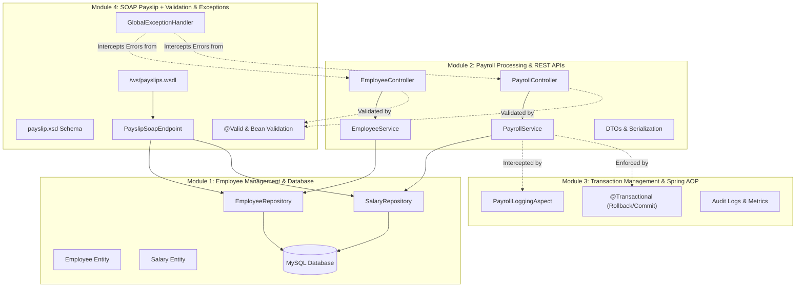
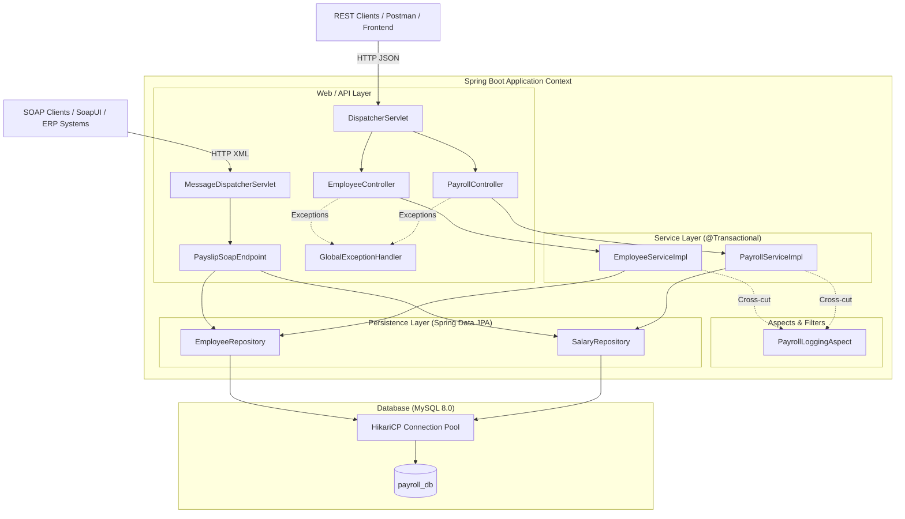
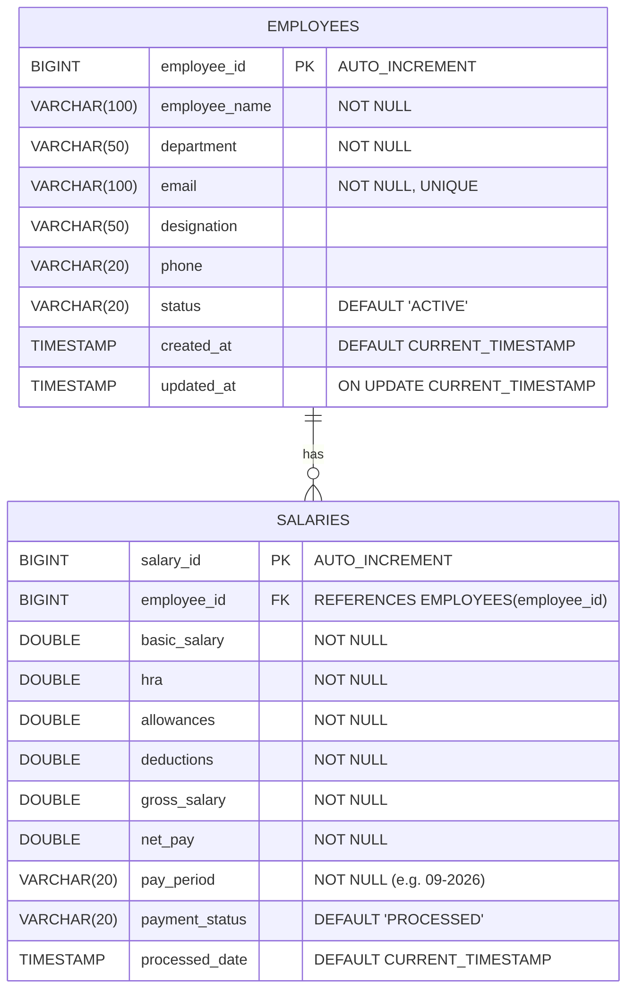
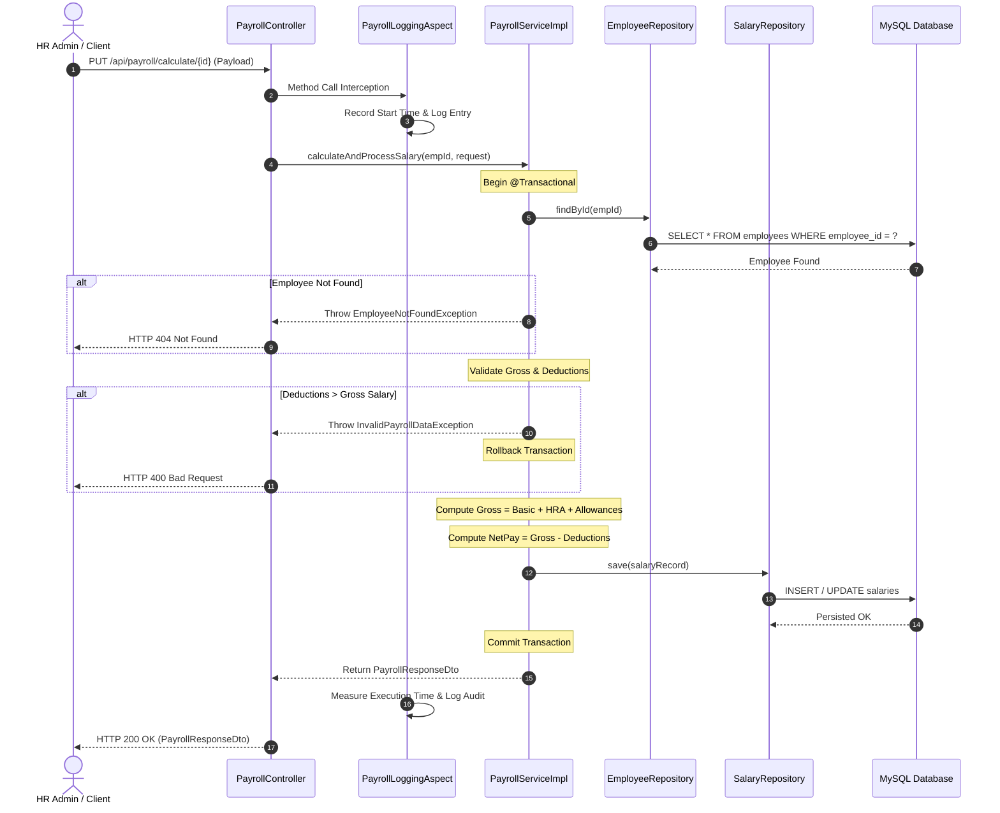
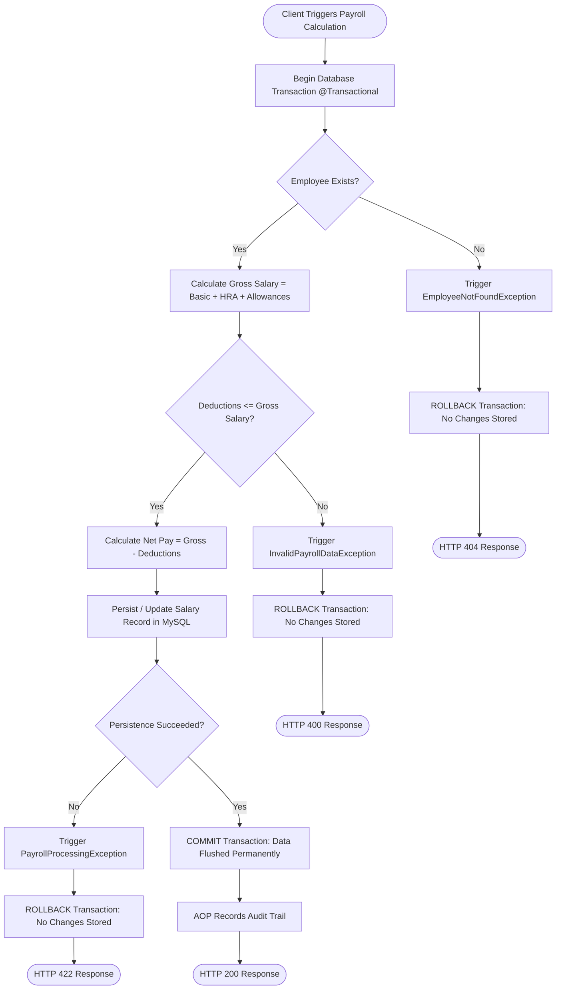

# Employee Payroll Management System

An enterprise-grade, production-ready Spring Boot backend application designed to automate, secure, and streamline corporate employee payroll processing, compliance tracking, and payslip generation.

---

## 1. Project Objective

The primary objective of the **Employee Payroll Management System** is to provide a reliable, modular, and scalable solution for corporate human resource and finance departments. It enforces:
- Strict relational integrity and validation across employee records and compensation schemes.
- Guaranteed ACID transactional integrity during multi-step salary computations to eliminate financial discrepancies.
- Non-intrusive aspect-oriented logging (Spring AOP) for complete auditability, performance metrics, and compliance.
- Multi-protocol interoperability by offering modern JSON **REST APIs** for day-to-day HR workflows alongside a contract-first XML **SOAP Web Service** (`/ws/payslips.wsdl`) for payslip distribution.

---

## 2. Technologies Used

| Technology | Purpose | Description / Version |
| :--- | :--- | :--- |
| **Java 21 / 26** | Language | Modern LTS Java runtime with virtual threads & strict type safety |
| **Spring Boot 3.3.4** | Framework | Production-ready application framework with auto-configuration |
| **Spring Data JPA / Hibernate** | Persistence | Object-Relational Mapping (ORM), entity lifecycle, and query abstraction |
| **MySQL 8.0+** | Database | High-performance relational database with InnoDB ACID transactions |
| **HikariCP** | Connection Pool | High-throughput, low-latency enterprise JDBC connection pooling |
| **Spring AOP (AspectJ)** | Aspect-Oriented | Cross-cutting method entry/exit, execution timing, and audit tracking |
| **Spring Web Services (Spring-WS)** | SOAP Web Services | Contract-first XML SOAP endpoint with dynamic WSDL generation |
| **WSDL4J** | WSDL Engine | Dynamic WSDL schema definition generator from XSD schema |
| **Jakarta Bean Validation** | Data Integrity | Declarative payload validation constraints (`@Valid`, `@NotBlank`, etc.) |
| **SLF4J / Logback** | Logging | Asynchronous, structured application logging |
| **Postman / SoapUI** | Testing & QA | Standard test suites for REST and SOAP communication |

---

## 3. The Four Core Modules

The application is structured into four distinct, loosely-coupled modules:



### Module 1: Employee Management & Database
- **Employee Entity (`Employee.java`)**: Manages master employee identity (`employeeId`, `employeeName`, `department`, `email`, `designation`, `phone`, `status`, `createdAt`, `updatedAt`).
- **Salary Entity (`Salary.java`)**: Stores compensation metrics (`salaryId`, `employee`, `basicSalary`, `hra`, `allowances`, `deductions`, `grossSalary`, `netPay`, `payPeriod`, `paymentStatus`).
- **Repositories (`EmployeeRepository`, `SalaryRepository`)**: Spring Data JPA repositories with query indexing.

### Module 2: Payroll Processing & REST APIs
- Layered architecture: `Controller` → `Service` → `Repository` → `MySQL`.
- Mathematical calculation:
  $$\text{Gross Salary} = \text{Basic Salary} + \text{HRA} + \text{Allowances}$$
  $$\text{Net Pay} = \text{Gross Salary} - \text{Deductions}$$
- REST Endpoints for employee registration, details retrieval, listing, updates, deletion, and monthly salary calculations.

### Module 3: Transaction Management & Spring AOP
- **`@Transactional(rollbackFor = Exception.class)`**: Guarantees that multi-step salary computations either commit completely or roll back atomically if validation rules or database errors occur.
- **`PayrollLoggingAspect`**: Intercepts service execution without modifying business logic:
  - `@Before`: Logs method invocation and parameters.
  - `@AfterReturning`: Logs successful execution and return states.
  - `@Around`: Measures execution duration in milliseconds.
  - `@AfterThrowing`: Captures exception traces.
  - Dedicated audit trail tracking successful salary commitments and rollbacks.

### Module 4: SOAP Payslip Web Service + Validation & Centralized Error Handling
- **Contract-First SOAP**: Implemented via Spring-WS. WSDL published at `/ws/payslips.wsdl` from `payslip.xsd`.
- **SOAP Endpoint (`PayslipSoapEndpoint`)**: Handles `getPayslipRequest` containing `employeeId` and `payPeriod`, returning a formatted `getPayslipResponse`.
- **Validation**: Enforces non-blank names, valid email patterns, positive salary components, and formatted pay periods (`MM-YYYY`).
- **`@RestControllerAdvice` (`GlobalExceptionHandler`)**: Intercepts `MethodArgumentNotValidException`, `EmployeeNotFoundException`, `InvalidPayrollDataException`, `DuplicateEmailException`, and produces uniform JSON error payloads.

---

## 4. System Architecture



---

## 5. Database Design

### Entity Relationship Diagram



---

## 6. Payroll Workflow



---

## 7. Transaction Flow (Commit vs. Rollback)



---

## 8. REST API Documentation

### Base URL: `http://localhost:8080/api`

### 1. Register Employee
- **URL**: `POST /api/employees`
- **Headers**: `Content-Type: application/json`
- **Request Body**:
  ```json
  {
    "employeeName": "John Doe",
    "department": "Engineering",
    "email": "john.doe@company.com",
    "designation": "Software Engineer",
    "phone": "+1-555-0101",
    "status": "ACTIVE"
  }
  ```
- **Response (201 Created)**:
  ```json
  {
    "success": true,
    "message": "Employee registered successfully",
    "data": {
      "employeeId": 1,
      "employeeName": "John Doe",
      "department": "Engineering",
      "email": "john.doe@company.com",
      "designation": "Software Engineer",
      "phone": "+1-555-0101",
      "status": "ACTIVE",
      "createdAt": "2026-09-09T11:30:00",
      "updatedAt": "2026-09-09T11:30:00"
    }
  }
  ```

### 2. Get Employee by ID
- **URL**: `GET /api/employees/{id}`
- **Response (200 OK)**:
  ```json
  {
    "success": true,
    "message": "Employee retrieved successfully",
    "data": {
      "employeeId": 1,
      "employeeName": "John Doe",
      "department": "Engineering",
      "email": "john.doe@company.com"
    }
  }
  ```

### 3. List All Employees
- **URL**: `GET /api/employees`
- **Response (200 OK)**: List of employee records wrapped in `ApiResponse`.

### 4. Update Employee
- **URL**: `PUT /api/employees/{id}`
- **Response (200 OK)**: Updated employee entity details.

### 5. Delete Employee
- **URL**: `DELETE /api/employees/{id}`
- **Response (200 OK)**: Success confirmation message.

### 6. Process & Calculate Monthly Payroll
- **URL**: `PUT /api/payroll/calculate/{id}`
- **Headers**: `Content-Type: application/json`
- **Request Body**:
  ```json
  {
    "payPeriod": "10-2026",
    "basicSalary": 60000.0,
    "hra": 24000.0,
    "allowances": 12000.0,
    "deductions": 6000.0
  }
  ```
- **Response (200 OK)**:
  ```json
  {
    "success": true,
    "message": "Payroll calculated and processed successfully",
    "data": {
      "salaryId": 1,
      "employeeId": 1,
      "employeeName": "John Doe",
      "department": "Engineering",
      "email": "john.doe@company.com",
      "basicSalary": 60000.0,
      "hra": 24000.0,
      "allowances": 12000.0,
      "deductions": 6000.0,
      "grossSalary": 96000.0,
      "netPay": 90000.0,
      "payPeriod": "10-2026",
      "paymentStatus": "PROCESSED",
      "processedDate": "2026-09-09T11:32:00"
    }
  }
  ```

---

## 9. SOAP API Documentation

- **WSDL URL**: `http://localhost:8080/ws/payslips.wsdl`
- **SOAP Endpoint URL**: `http://localhost:8080/ws`
- **Target Namespace**: `http://example.com/payroll/soap`

### Sample SOAP Request
```xml
<soapenv:Envelope xmlns:soapenv="http://schemas.xmlsoap.org/soap/envelope/"
                  xmlns:soap="http://example.com/payroll/soap">
    <soapenv:Header/>
    <soapenv:Body>
        <soap:getPayslipRequest>
            <soap:employeeId>1</soap:employeeId>
            <soap:payPeriod>10-2026</soap:payPeriod>
        </soap:getPayslipRequest>
    </soapenv:Body>
</soapenv:Envelope>
```

### Sample SOAP Response
```xml
<SOAP-ENV:Envelope xmlns:SOAP-ENV="http://schemas.xmlsoap.org/soap/envelope/">
    <SOAP-ENV:Header/>
    <SOAP-ENV:Body>
        <ns2:getPayslipResponse xmlns:ns2="http://example.com/payroll/soap">
            <ns2:employeeId>1</ns2:employeeId>
            <ns2:employeeName>John Doe</ns2:employeeName>
            <ns2:department>Engineering</ns2:department>
            <ns2:email>john.doe@company.com</ns2:email>
            <ns2:payPeriod>10-2026</ns2:payPeriod>
            <ns2:basicSalary>60000.0</ns2:basicSalary>
            <ns2:hra>24000.0</ns2:hra>
            <ns2:allowances>12000.0</ns2:allowances>
            <ns2:deductions>6000.0</ns2:deductions>
            <ns2:grossSalary>96000.0</ns2:grossSalary>
            <ns2:netPay>90000.0</ns2:netPay>
            <ns2:status>PROCESSED</ns2:status>
            <ns2:generatedDate>2026-09-09 11:35:00</ns2:generatedDate>
        </ns2:getPayslipResponse>
    </SOAP-ENV:Body>
</SOAP-ENV:Envelope>
```

---

## 10. Validation & Centralized Error Handling

All incoming HTTP and SOAP inputs are strictly validated. If a constraint fails, a structured JSON response is emitted:

```json
{
  "timestamp": "2026-09-09T11:36:00",
  "status": 400,
  "error": "Validation Error",
  "message": "Invalid request payload. Please verify input data.",
  "details": [
    "employeeName: Employee name must be between 2 and 100 characters",
    "email: Invalid email format"
  ]
}
```

| HTTP Status | Trigger Condition | Handled Exception |
| :--- | :--- | :--- |
| **400 Bad Request** | Missing fields, bad formatting, or deductions > gross salary | `MethodArgumentNotValidException`, `InvalidPayrollDataException` |
| **404 Not Found** | Employee or payroll record does not exist | `EmployeeNotFoundException` |
| **409 Conflict** | Email address is already registered | `DuplicateEmailException` |
| **422 Unprocessable** | Transactional processing failure | `PayrollProcessingException` |
| **500 Internal Error** | Unhandled system exception | `Exception` |

---

## 11. Testing Instructions

### A. Pre-requisites
1. MySQL Server running on `localhost:3306` with credentials `root` / `root`.
2. The database `payroll_db` is auto-created or can be created manually:
   ```bash
   mysql -u root -proot -e "CREATE DATABASE IF NOT EXISTS payroll_db;"
   ```

### B. Running the Application
Run the project via Maven wrapper:
```bash
.\mvnw.cmd spring-boot:run
```

### C. Testing with Postman
1. Open Postman.
2. Click **Import** → Choose `postman_collection.json` located at the project root.
3. Run the requests sequentially:
   - `Register New Employee`
   - `Get Employee by ID`
   - `Calculate Monthly Salary`
   - `Transaction Rollback Test`
   - `Validation Error Tests`

### D. Testing with SoapUI
1. Open SoapUI.
2. Click **File** → **New SOAP Project**.
3. Set Project Name: `EmployeePayrollSoap`.
4. Set Initial WSDL: `http://localhost:8080/ws/payslips.wsdl`.
5. Open `getPayslip` request and paste the test XML from `soapui_requests.xml`.
6. Submit the request and verify the XML response.

---

## 12. Scalability & Future Enhancements

1. **Pagination & Sorting**: Incorporate `Pageable` on `GET /api/employees` to handle hundreds of thousands of staff records without memory exhaustion.
2. **Spring Batch Integration**: Enable asynchronous batch payroll jobs for processing enterprise salary runs for 100,000+ employees simultaneously.
3. **Database Read Replicas**: Distribute read-heavy queries (such as payslip downloads and reporting) to MySQL read-only replicas using routing data sources.
4. **Redis Caching**: Cache active employee profiles and historical salary slips using Spring Cache `@Cacheable` to reduce direct database hits.
5. **Distributed Tracing & OpenTelemetry**: Expand the AOP logging aspect into OpenTelemetry/Zipkin spans for microservice observability.

---

## 13. Project Team & Collaborators

| Contributor | GitHub Profile |
| :--- | :--- |
| **P. Chaitanya** | [@ParamataChaitanya](https://github.com/ParamataChaitanya) |
| **Mukku Takur Reddy** | [@Takurreddy](https://github.com/Takurreddy) |
| **Akhil** | [@Akhilyalamanchili](https://github.com/Akhilyalamanchili) |
| **Raviteja Kolaparthi** | [@Ravitejakolaparthi](https://github.com/Ravitejakolaparthi) |

